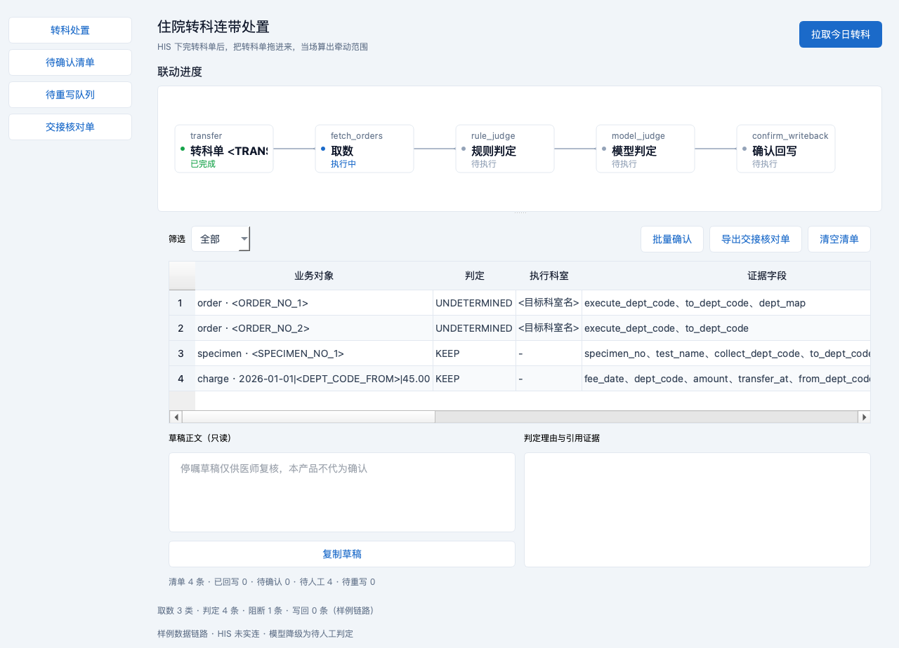
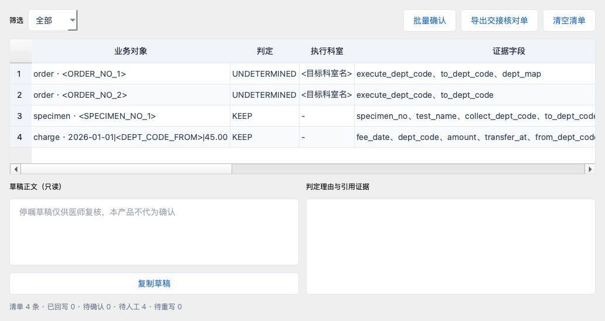
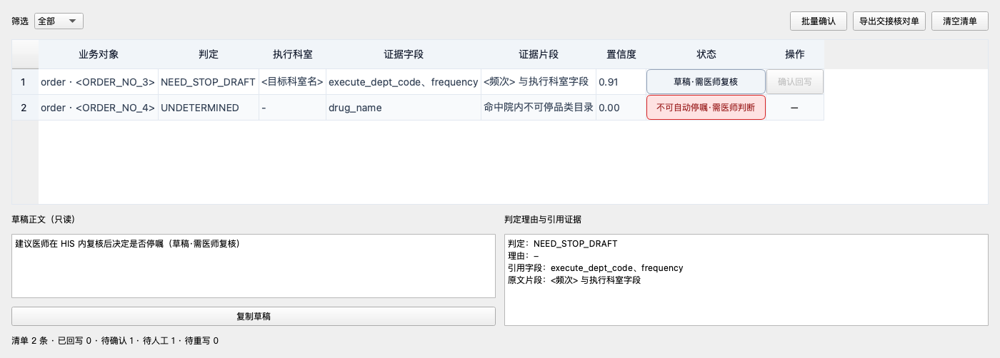
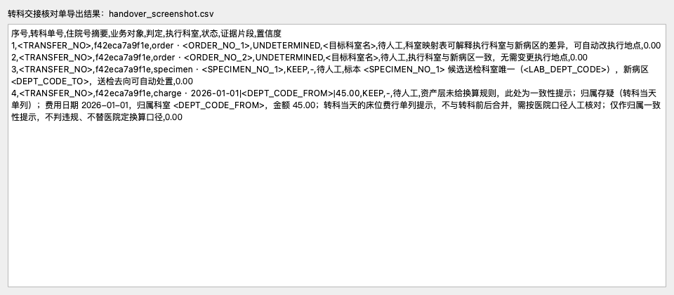

# 住院转科连带处置系统

> HIS 里下完转科单之后，把转科单拖进窗口，当场算出这次牵动几条在执行长嘱、几张待送标本、哪一项床位费归属；护士长逐条确认后写回 HIS，并导出转科交接核对单交病区。

住院转科在 HIS 里只改「患者所在科室」这一行字段，但在执行长嘱的换科室执行、待送标本的送检去向、跨科室那天的床位费归属分属不同模块，各改各的，漏一处就串单或重复计费。这个工具把一次转科牵动的范围一次算清、一次逐条确认、一次写回，状态存在本机，重开可续跑。

## 适用场景 / 目标岗位

| 岗位 | 什么时候用 | 得到什么 |
|------|------------|----------|
| 住院服务中心经办 | HIS 下完转科单那一刻 | 一张转科单进来，当场看到这次牵动多少条长嘱、几张标本、哪几项费用 |
| 病区护士长 | 转科单送来、要安排下一班执行时 | 一张逐条处置清单：每条该改成哪个科室、凭什么这么判、要不要人工看 |
| 医师 | 发现转科后有长嘱该停不该停时 | 一份停嘱草稿，标注「需医师复核」，在 HIS 里自行处置，不代签不自动提交 |
| 信息科 | 科室调整、处置动作类型要加一条时 | 可直接维护的科室映射表与处置类型目录（JSON），加载后立即生效 |
| 医保办 / 内审 | 转科当天床位费归属说不清时 | 一条归属一致性提示，说明哪里需要人工核对，不替医院定口径 |

## 能力要点

- **一张转科单，算清全部牵动**：在执行长嘱、待送标本、床位费三类数据一次性取回并归到同一张转科单下，不用在三个模块之间各查各的。
- **该长的处置才长**：没有在执行长嘱就不出现「改执行地点」条目，没有待送标本就不出现「送标本去向」条目；清单里不会混进不存在的事。
- **每条判定都说清凭什么**：给出命中的规则编号、引用的医嘱字段名和原文片段、置信度，护士长能自己复核，而不是只看到一个结论。
- **拿不准的明确交给人**：标本送检去向不唯一、执行科室对不上、命中不可停品类，一律挂人工待办并写明原因，绝不按「最像的」猜。
- **确认后才动 HIS**：未确认的条目一个写请求都不发；写回带幂等键，护士长连点两次也只写一次。
- **停嘱只出草稿**：停嘱永远停在「草稿·需医师复核」，界面没有提交或签名入口，草稿正文可复制到 HIS 由医师手工处置。

## 快速开始

### 依赖

- Python ≥ 3.11
- 桌面环境（Linux 需 `libxcb` 等 Qt 运行库；macOS / Windows 官方轮子自带）
- 出站可达：院内 HIS 地址 1 个、模型服务地址 1 个

### 安装

```bash
git clone <本仓库地址> && cd inpatient-transfer-cascade
python3 -m venv .venv && source .venv/bin/activate
pip install -r requirements.txt
```

### 配置

复制配置模板并填入院内地址与凭据；所有配置项也可用同名环境变量注入（环境变量优先）。

```bash
cp .env.example .env
# 编辑 .env：填 HIS_BASE_URL / HIS_API_TOKEN / LLM_BASE_URL / LLM_API_KEY / LLM_MODEL
```

`HIS_API_TOKEN` 与 `LLM_API_KEY` 只从环境变量读取，不写入任何配置文件；`.env` 已在 `.gitignore` 中排除。

### 构建与验证

```bash
python -m itc doctor                 # 自检配置齐备性与 HIS 端点可达性
python -m pytest tests -q            # 跑全部测试
python -m itc run --transfer fixtures/transfer_sample.json --sample-data
# 上一步用脱敏样例跑最小链路，产出牵动范围清单 / 逐条处置清单 / 交接核对单；接真实 HIS 时去掉 --sample-data 并配置凭据
```

### 主命令速查

```bash
python -m itc                       # 启动桌面程序（窗口 + 托盘常驻）
python -m itc doctor                # 配置与出站自检
python -m itc run --transfer <file> --sample-data  # 脱敏样例最小链路（不出网）
python -m itc run --transfer <file> --confirm   # 同上，并在逐条确认后写回 HIS
python tools/fetch_datasets.py --check           # 检查样例数据规模与完整性
```

## 命令 / API / 配置说明

### 关键配置项

| 配置项 | 默认值 | 说明 |
|--------|--------|------|
| `HIS_BASE_URL` | 无（必填） | 院内 HIS / ESB 基地址；出站读与写的目标 |
| `HIS_API_TOKEN` | 无（必填） | 出站访问令牌，统一带 `Authorization: Bearer <token>` |
| `LLM_BASE_URL` | 无（可空） | OpenAI-compatible 模型服务基地址；留空表示模型不可达，主路径降级 |
| `LLM_API_KEY` | 无（可空） | 模型服务访问令牌 |
| `LLM_MODEL` | 无（可空） | 判定长嘱归属所用模型名 |
| `LLM_TIMEOUT_SECONDS` | `30` | 单次模型调用超时（秒） |
| `ITC_STATE_DB` | `~/.itc/state.sqlite3` | 本地状态库路径（处置台账、阻塞、缓存、幂等登记） |
| `ITC_RULES_DIR` | `./src/itc/rules/catalogs` | 院内维护的规则目录（科室映射表、不可停品类目录） |

### CLI 子命令 / 接口端点

| 命令或路径 | 用途 | 关键参数 |
|------------|------|----------|
| `python -m itc` | 启动桌面常驻程序（窗口 + 托盘） | 无 |
| `python -m itc doctor` | 检查配置齐备性与 HIS / 模型可达性 | 无 |
| `python -m itc run --transfer <file>` | 跑一张转科单，产出牵动范围清单与逐条处置清单 | `--transfer` 转科单 JSON；`--confirm` 是否写回 HIS；`--db` 状态库路径 |
| `python -m itc ledger list` | 查处置台账（按转科单号 / 状态 / 科室 / 时间筛） | `--transfer` `--status` `--dept` `--from` `--to` |
| `python -m itc handover --transfer <file>` | 导出一张转科交接核对单（脱敏） | `--transfer` `--out` 输出路径 |
| `python tools/fetch_datasets.py` | 获取 / 生成样例数据集（可重跑、断网降级） | `--check` 只校验规模与完整性；`--offline` 强制用本地已有数据 |
| `python tools/bench_run.py` | 批量跑样例并统计耗时与缓存命中 | `--samples` 样例条数 |

### 错误与降级

| 场景 | 表现 | 处理方式 |
|------|------|----------|
| HIS 不可达 | 取数节点失败，图不推进 | 零写请求；界面错误态给出「HIS 未连通，检查地址与令牌」；重试入口在托盘菜单 |
| 模型不可达 / 超时 / 返回不可解析 | 语义判定项判不出结论 | 降级为「只出规则可判清单，语义项一律标『待人工判定』」；不发任何停嘱类写请求；状态不被误推进 |
| 写回 5xx | 写回失败 | 指数退避重试 ≤2 次；超次置 `pending_writeback` 并在托盘点提示数量，不静默丢弃 |
| 写回 4xx（字段错 / 权限不足） | 写回被拒 | 不重试，直接失败并给出可读原因（缺哪个字段、哪个权限） |
| 标本送检去向不唯一 | 送检科室定不下来 | 挂人工待办并列出候选科室与需要人判断的原因；不进入写回路径 |
| 命中不可停品类（输血 / 危急值相关 / 抗菌药） | 该长嘱不能自动停 | 不生成停嘱草稿，条目标「不可自动停嘱·需医师判断」 |
| 科室映射缺失 | 新旧科室对不上 | 返回需人工判定，不猜；缺映射场景零自动处置请求 |
| 转科单字段不合规 | 拖入的 JSON 字段缺失或类型不对 | 行级提示指出哪个字段不对，拒收该单，不进入建图 |

### 对接现有系统

出站只做两类：**读 4 类 HIS 资源**、**写 2 个 HIS 接口**。凭据一律从环境变量读，不落配置文件、不进日志。

**读（`Authorization: Bearer $HIS_API_TOKEN`）**

| 资源 | 方法与路径 | 关键字段 |
|---|---|---|
| 转科单 | `GET /api/v1/transfers/{transfer_id}` | 转科单号、住院号、原 / 目标科室、病区、转科时间 |
| 今日转科 | `GET /api/v1/transfers?ward=&date=` | 同上，按病区与日期过滤 |
| 在执行医嘱 | `GET /api/v1/inpatients/{inpatient_no}/orders?status=executing` | 医嘱号、内容、药品名、给药途径、频次、执行科室、开始时间 |
| 待送标本 | `GET /api/v1/inpatients/{inpatient_no}/specimens?status=pending` | 标本号、检验项目、采集科室、状态 |
| 床位费明细 | `GET /api/v1/inpatients/{inpatient_no}/charges?category=bed` | 费用类别、费用日期、金额、科室 |

**写（带 `Authorization: Bearer $HIS_API_TOKEN`）**

| 用途 | 方法与路径 | 关键字段与约束 |
|---|---|---|
| 执行地点变更 | `POST /api/v1/orders/{order_id}/execution-site` | 住院号、医嘱号、执行科室编码 / 名称、生效时间、`reason=TRANSFER_CASCADE`、转科单号；头 `Idempotency-Key` = 业务字段哈希 |
| 停嘱草稿（不提交） | `POST /api/v1/orders/drafts` | 住院号、医嘱号、`draft_type=STOP`、草稿正文、来源转科单号、`status=DRAFT`；**产品不提供提交 / 签名路径** |

幂等键 = `sha256(转科单号 | 医嘱号 | 执行科室编码 | 生效时间)`，与时间戳和重试次数无关；同一转科单重复确认、重试、进程重启后再跑，都不会产生第二次写请求。

```bash
# 出站形态示例（真实实现走 httpx 客户端，凭据只从环境变量读）
export HIS_BASE_URL="https://his-internal.example-hospital.local"
export HIS_API_TOKEN="<令牌>"
python -m itc doctor   # 自检这两个配置与端点可达性
```

本地替身与合成数据**只出现在测试数据层**，不是产品边界：产品的默认路径指向真实 HIS 端点，不设 mock 开关。

## 典型场景

### 场景 1：护士长收到一张转科单

1. 把 HIS 导出的转科单 JSON 拖进窗口（或点「拉取今日转科」从院内拉）。
2. 窗口当场算出这次牵动多少条在执行长嘱、几张待送标本、哪一项床位费，联动图显示每一步跑到哪儿。
3. 逐条看清单：判定、执行科室、证据片段、置信度都在一行里。

```bash
python -m itc run --transfer fixtures/transfer_sample.json --sample-data
# 产出：outputs/ 下的牵动范围清单 JSON + 逐条处置清单 + 交接核对单
```

### 场景 2：护士长逐条确认后写回

1. 清单里确认要改执行地点的条目，每条点一次「确认」，才发一次写请求。
2. 涉及停嘱的条目显示「草稿·需医师复核」，按钮不可点，草稿正文可复制。
3. 写回失败的条目进待重试队列，托盘点提示数量。

```bash
python -m itc run --transfer fixtures/transfer_sample.json --confirm
# 每条已确认项各 1 次写请求；带幂等键；未确认项 0 次
```

### 场景 3：交班时导出交接核对单

1. 处置完成后点「导出交接核对单」。
2. 导出一张脱敏表格交病区：住院号只留摘要，条目状态区分已回写 / 待确认 / 待人工。

```bash
python -m itc handover --transfer fixtures/transfer_sample.json --out outputs/handover.csv
# 条目数与台账一致；不含姓名 / 身份证 / 联系方式
```

## 输出样例

### 牵动范围清单

```json
{
  "transfer_no": "<TRANSFER_NO>",
  "inpatient_no": "<INPATIENT_NO>",
  "items": [
    {"kind": "order", "ref": "<ORDER_NO_1>", "action": "CHANGE_SITE", "note": "执行科室仍在原科室"},
    {"kind": "order", "ref": "<ORDER_NO_2>", "action": "KEEP", "note": "执行科室已在目标科室"},
    {"kind": "specimen", "ref": "<SPECIMEN_NO_1>", "action": "RESEND_ROUTE", "note": "待送标本去向需改"},
    {"kind": "charge", "ref": "<DEPT_CODE_FROM>", "action": "BED_FEE_HINT", "note": "转科当天床位费归属存疑"}
  ]
}
```

### 逐条处置清单

```
┌ 业务对象 ──────────┬ 判定 ─────────┬ 执行科室 ──────┬ 证据片段 ──────────────┬ 状态 ────────┐
│ 长嘱 <ORDER_NO_1>  │ 改执行地点   │ <目标科室名>  │ 频次 <频次 1>…        │ 待确认       │
│ 长嘱 <ORDER_NO_2>  │ 保持不动     │ <目标科室名>  │ 执行科室已在目标科室   │ 已回写       │
│ 标本 <SPECIMEN_NO> │ 改送检去向   │ <目标科室名>  │ 采集科室 <原科室名>    │ 待人工判定   │
│ 停嘱草稿 <ORDER>   │ 草稿·需医师复核 │ —          │ 命中不可停品类         │ 不可自动停嘱 │
└────────────────────┴───────────────┴───────────────┴──────────────────────┴──────────────┘
```

### 转科交接核对单

导出为可打印表格，字段与台账一致、状态区分已回写 / 待确认 / 待人工；真实导出结果见 `docs/screenshots/05-handover.png`。

## 概念 / 实测对照

### 视觉目标

结构化视觉目标卡见 `docs/concepts/visual-target.md`：起始态、首个可用瞬间、成形态三态画面，含具体色值、字体层级、8px 间距栅格与「必须可达」约束清单。本环境不具备图像生成能力，因此没有概念图，只保留结构化视觉目标卡，不伪造图片。

### 实测证据

以下截图由 `python tools/capture_screenshots.py` 在真实运行的桌面程序上采集（先跑通样例主路径，再抓取窗口与导出结果），不是设计稿或示意图：







> **诚实标注**：视觉目标是设计意图（上），实测证据是真实运行画面（下）。两者有可见差距：目标卡描述信息层级与配色的理想态，实测是浅色工作台的实际渲染，联动图节点仍以类型 id 显示、表格列在 1280 宽度下需要横向滚动。不会用事后效果图抹平这个差距，也不声称两者完全一致。

## 架构与数据流

```
  转科单 JSON / HIS 今日转科
            │
            ▼
    ┌───────────────────┐
    │  入队与建图        │  校验字段 → 按模板装配节点图
    └───────────────────┘
            │
            ▼
    ┌────────────────────────────────────────────────┐
    │  联动图执行（依赖就绪顺序）                     │
    │  取数节点 → 规则判定 → 模型判定 → 确认回写      │
    │   ▲ 运行时按患者当下数据长出处置节点             │
    │   ▲ 取数节点触底时停住等人（外部阻塞，落盘）     │
    └────────────────────────────────────────────────┘
            │                    │
            ▼                    ▼
   ┌─────────────┐      ┌──────────────────┐
   │  HIS 出站    │      │  模型网关         │
   │  读 4 / 写 2 │      │  OpenAI-compatible│
   └─────────────┘      └──────────────────┘
            │                    │
            └────────┬───────────┘
                     ▼
        ┌────────────────────────┐
        │  处置台账（SQLite）      │
        │  7 态状态机 + 审计哈希链 │
        └────────────────────────┘
                     │
                     ▼
          转科交接核对单（脱敏导出）
```

### 关键不变量

- **幂等键**：写回键 = `sha256(转科单号 | 医嘱号 | 执行科室编码 | 生效时间)`，与时间戳、重试次数无关；重复确认不产生第二次写请求。
- **状态只前进**：处置项 7 态单向迁移，非法迁移（例如未确认直接到已回写）抛错且状态不变；重跑另开记录，不覆盖原记录。
- **确认前零写请求**：未逐条确认的条目不产生任何出站写调用；停嘱类在降级态下写请求恒为 0。
- **失败不静默改数据**：HIS 不可达则图不推进；写回超次进待重写队列；模型不可达则语义项转人工，状态不被误推进。
- **实体绑定不唯一即拒绝**：住院号 / 医嘱号 / 标本号由 HIS 定义，跨表匹配不唯一时挂人工待办，绝不按最近似猜。
- **审计链只增不改**：每条事件含前一条哈希，篡改可定位断点；本机库与日志只留住院号摘要，不落姓名 / 身份证 / 联系方式。

## 安全与合规边界

- 本工具只做**文书草稿与结构整理**：输出的是待人工复核的处置建议与停嘱草稿，不给诊断或治疗建议。
- **不代签、不自动提交**：停嘱永远停在 `DRAFT`，界面无提交 / 签名入口，代码中不存在提交医嘱的调用路径；草稿由医师在 HIS 内自行处置。
- **模型输出不推进业务状态**：模型只参与「这条长嘱在转科后是否仍属新病区」这类语义判定与草稿起草，结果须经护士长逐条确认才写回；模型不可达时降级为规则可判清单。
- **不接管 HIS 内部事务**：只读 4 类资源、写 2 个接口，写请求带幂等键，不在院内库上做跨表事务。
- **最小数据出网**：模型请求体只含住院号摘要与医嘱字段（医嘱号、内容、药品名、给药途径、频次、执行科室），不含姓名、身份证、联系方式；本地库与日志同样只留住院号摘要。

## 验收与自检

| 验收项 | 命令 | 期望结果 |
|--------|------|----------|
| 配置与出站自检 | `python -m itc doctor` | 列出配置齐备性、HIS 与模型可达性；缺凭据时明确报错而非静默降级 |
| 最小链路可跑通 | `python -m itc run --transfer fixtures/transfer_sample.json --sample-data` | 产出牵动范围清单、逐条处置清单与交接核对单，清单含 `transfer_no` 与 `items` |
| 未确认不写回 | 同上（不带 `--confirm`） | 写请求数为 0 |
| 确认后才写回且幂等 | `python -m itc run --transfer fixtures/transfer_sample.json --confirm` | 每条已确认项各 1 次写请求；重复提交不产生第二次写请求 |
| 停嘱只出草稿 | 同上 | 草稿标「草稿·需医师复核」，代码路径无提交调用 |
| 测试全绿 | `python -m pytest tests -q` | 全部通过 |
| 样例数据规模 | `python tools/fetch_datasets.py --check` | 转科事件 ≥200、在执行医嘱 ≥1000、待送标本 ≥400、床位费 ≥200 |
| 交接单与台账一致 | `python -m itc handover --transfer fixtures/transfer_sample.json --out outputs/handover.csv` | 条目数与台账处置项数一致，不含姓名 / 身份证 / 联系方式 |

## 项目结构

```
inpatient-transfer-cascade/
├── README.md                    # 产品说明（本文）
├── README_EN.md                 # 英文摘要说明
├── LICENSE                      # MIT 许可
├── qrcode.jpg                   # 公众号二维码
├── requirements.txt             # 运行依赖清单
├── .env.example                 # 配置模板（真实凭据只走环境变量）
├── .gitignore                   # 排除运行时数据与凭据
├── docs/
│   ├── concepts/visual-target.md  # 结构化视觉目标卡（三态画面 + 色值 + 可达约束）
│   ├── screenshots/             # 真实运行截图（收尾阶段采集）
│   ├── cli.md                   # CLI 全子命令与参数参考
│   └── architecture.md          # 逐文件目录树、状态机、审计链、联动图结构
├── fixtures/                    # 提交的脱敏小样例（占位标识，无拟真住院号与姓名）
│   ├── transfer_sample.json     # 转科单样例
│   ├── orders_sample.json       # 在执行长嘱样例
│   ├── specimens_sample.json    # 待送标本样例
│   └── charges_sample.json      # 床位费明细样例
├── tools/
│   ├── fetch_datasets.py        # 样例数据获取与规模校验（可重跑、断网降级）
│   └── bench_run.py             # 批量跑样例与性能统计
├── src/itc/
│   ├── __main__.py              # CLI 入口（doctor / run / ledger / handover）
│   ├── app.py                   # 桌面装配：QApplication + 托盘常驻
│   ├── config.py                # 配置面（pydantic-settings，全环境变量注入）
│   ├── domain/models.py         # 临床实体：转科单 / 医嘱 / 标本 / 费用 / 处置项
│   ├── graph/                   # 联动图执行内核：节点与序列化 / 建图校验 / 就绪调度与环检测 / 动态插节点
│   │   │                       #   与父链回溯 / 阻断与外部阻塞 / 落盘缓存 / 幂等键 / 执行主循环 / 审计链
│   ├── his/                     # HIS 出站对接层：客户端 / 读 4 类 / 写 2 类 / 错误分类与退避 / 脱敏
│   ├── rules/                   # 规则与守门：科室映射 / 执行科室硬矛盾 / 标本去向唯一性 / 不可停品类 /
│   │   │                       #   床位费归属提示 / 规则目录加载 / 院内目录 JSON
│   ├── model_gateway/           # 模型网关：OpenAI-compatible 客户端 / 判定 Schema / 提示模板 / 错误
│   │   │                       #   语义 / 调用审计元数据
│   ├── store/                   # 状态与台账：SQLite schema 与迁移 / 处置项 7 态状态机 / 重启恢复 /
│   │   │                       #   台账查询导出 / 写回幂等登记表
│   ├── catalog/                 # 处置动作类型目录（注册 + 自定义类型加载 + 未知类型容错）
│   └── ui/                      # 桌面界面：设计 token / 主窗口与导入 / 联动图视图 / 处置清单与确认回写 /
│       │                       #   停嘱草稿呈现与无提交护栏 / 托盘常驻 / 交接核对单导出
└── tests/                       # 对照测试 / 契约测试 / 边界测试
```

逐文件目录树、处置项 7 态状态机与审计链结构见 `docs/architecture.md`；CLI 全子命令与参数见 `docs/cli.md`。

## License

MIT

---

## 关注我们

欢迎扫码关注公众号，获取项目更新与交流加群：

