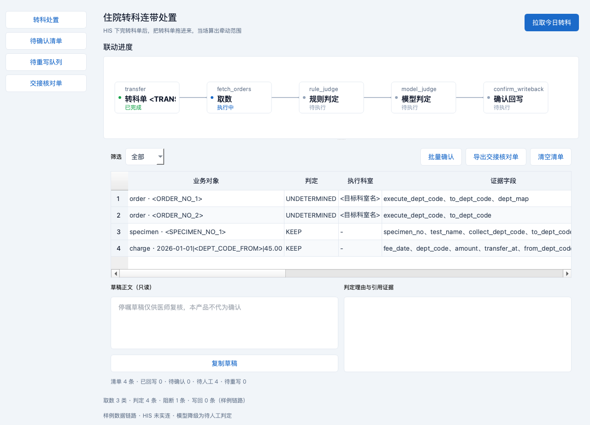
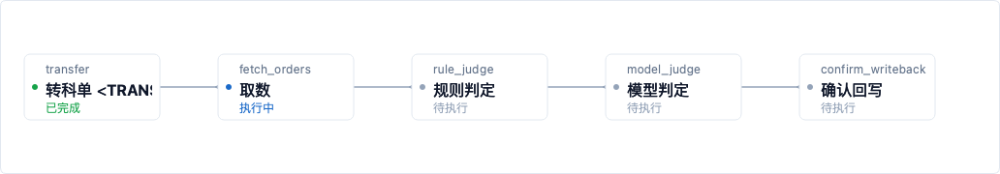
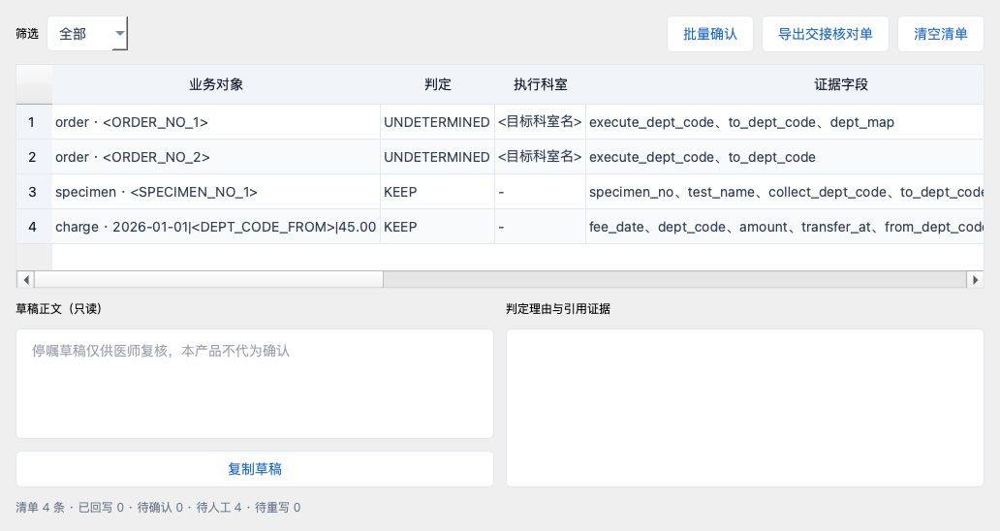
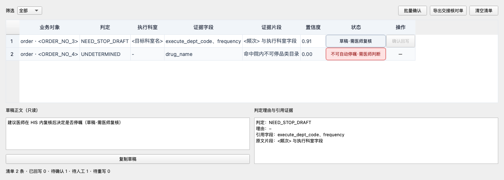
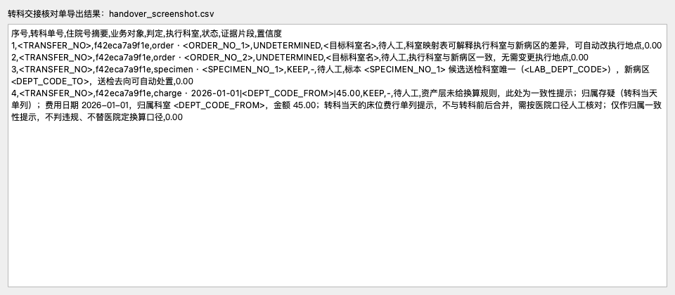

# Inpatient Transfer Cascade

> Drop a transfer order into the desktop window after it is issued in the HIS. The tool
> immediately computes which long-term orders pending specimens and bed-fee items are
> affected; the head nurse confirms items one by one writes the execution-site changes
> back to the HIS and exports a handover checklist for the ward.

A transfer in a hospital information system only changes the patient's department field.
The execution site of active long-term orders the destination of pending specimens and
the bed-fee attribution on the transfer day live in different modules. Missing any one
of them causes misrouted orders or duplicate charges. This desktop tool computes the
full impact in one pass presents one confirmable checklist writes back once and keeps
its state in a local SQLite file so it can resume after a restart.

## Who uses it

| Role | When | What they get |
|---|---|---|
| Admission service clerk | Right after a transfer order is issued | The affected scope of that single order |
| Ward head nurse | When arranging the next shift | A per-item checklist with evidence and a confirm button |
| Physician | When a long-term order should be stopped | A stop-order **draft** marked for physician review; never signed or submitted |
| IT department | When departments or action types change | Maintainable JSON mapping tables and action catalogs |
| Medical records / internal audit | When bed-fee attribution is unclear | A consistency hint describing what needs manual review |

## Capabilities

- **One transfer, one complete scope.** Active orders, pending specimens and bed charges are gathered under one transfer number instead of three separate lookups.
- **Only applicable actions appear.** No active long-term orders means no execution-site item; no pending specimens means no specimen-routing item.
- **Every judgement is explainable.** Rule id, referenced order fields, evidence snippet and confidence are shown per row.
- **Ambiguity is escalated.** Non-unique specimen destinations, unexplained execution departments and non-stoppable drug categories become manual to-dos; the tool never guesses the closest match.
- **Confirmation precedes any write.** Unconfirmed items generate zero outbound write requests; idempotency keys keep double clicks from writing twice.
- **Stop orders stop at draft.** The label "Draft - physician review required" is permanent, there is no submit or signature entry, and the draft text can be copied into the HIS manually.

## Quick start

### Requirements

- Python 3.11 or newer and a desktop Qt environment (PySide6)
- One reachable HIS endpoint and optionally one OpenAI-compatible model endpoint

### Install

```bash
git clone <repository-url> && cd inpatient-transfer-cascade
python3 -m venv .venv && source .venv/bin/activate
pip install -r requirements.txt
```

### Configure

```bash
cp .env.example .env
# Fill HIS_BASE_URL / HIS_API_TOKEN / LLM_BASE_URL / LLM_API_KEY / LLM_MODEL
```

All credentials are read from environment variables only. `.env` is excluded by
`.gitignore`. Leaving the model configuration empty is supported: semantic items
degrade to "pending manual review" and no stop-draft write requests are sent.

### Build and verify

```bash
python -m itc doctor
python -m pytest tests -q
python -m itc run --transfer fixtures/transfer_sample.json --sample-data
```

`--sample-data` is an explicit de-identified fixture run. It is not a mock switch: the
default product path always points at the real HIS endpoint. The command produces
`outputs/scope_list.json`, `outputs/disposition_list.json` and `outputs/handover.csv`.

### Command quick reference

```bash
python -m itc                                  # desktop window + system tray
python -m itc doctor                           # configuration and endpoint self-check
python -m itc run --transfer <file> --confirm  # full run with HIS write-back
python -m itc ledger list --status written_back
python -m itc handover --transfer <file> --out outputs/handover.csv
python -m itc replay --run <run_id>
python tools/fetch_datasets.py --check
python tools/bench_run.py --samples 200
```

The full command reference is in [docs/cli.md](docs/cli.md); state machine, audit
chain and graph structure are documented in [docs/architecture.md](docs/architecture.md).

## Configuration

| Variable | Default | Purpose |
|---|---|---|
| `HIS_BASE_URL` | required | HIS / ESB base URL |
| `HIS_API_TOKEN` | required | Bearer token for outbound calls |
| `LLM_BASE_URL` | empty | OpenAI-compatible model service base URL |
| `LLM_API_KEY` | empty | Model service token |
| `LLM_MODEL` | empty | Model used for order-attribution judgement |
| `LLM_TIMEOUT_SECONDS` | `30` | Per-call timeout in seconds |
| `ITC_STATE_DB` | `~/.itc/state.sqlite3` | Local SQLite state file |
| `ITC_RULES_DIR` | packaged catalogs | Hospital-maintained rule directory |

## Integration surface

Outbound reads: transfer detail, today's transfers, executing orders, pending
specimens, bed charges. Outbound writes: execution-site change and stop-order draft
(`status=DRAFT`). Every write carries `Authorization: Bearer $HIS_API_TOKEN`; the
execution-site change carries `Idempotency-Key =
sha256(transfer_no|order_no|execute_dept_code|effective_from)`, which is independent of
timestamps and retry counts. There is no submit or sign path in the product code.
Protocol stand-ins (`httpx.MockTransport`) and synthetic samples exist only in the test
layer.

## Safety and compliance

- Output is documentation support: suggestions, drafts, structural hints. No diagnosis
  or treatment advice is produced.
- Stop orders remain `DRAFT`; the product does not sign or submit them.
- Model output never advances clinical state on its own; a nurse confirms each row.
- Only de-identified data leaves the process: the model request body contains a hashed
  inpatient number plus order fields, never names, ID numbers or contact details.
- Local database and structured logs keep only hashed inpatient numbers; the audit
  chain is append-only and hash-linked.

## Verification

| Check | Command | Expected |
|---|---|---|
| Configuration self-check | `python -m itc doctor` | Reports missing credentials explicitly |
| Minimum runnable path | `python -m itc run --transfer fixtures/transfer_sample.json --sample-data` | Three artifacts produced, zero write requests |
| Confirmation gate | same command without `--confirm` | Zero write requests |
| Idempotent write-back | `python -m pytest tests/test_end_to_end.py -q` | One POST per confirmed item; repeat run adds none |
| Test suite | `python -m pytest tests -q` | All tests pass |
| Sample dataset scale | `python tools/fetch_datasets.py --check` | >=200 transfers, >=1000 orders, >=400 specimens, >=200 bed charges |

## Visual target vs. real screenshots

The structured visual target card is `docs/concepts/visual-target.md`. Real runtime
screenshots captured with `python tools/capture_screenshots.py` are:







**Honest note:** the visual target is the design intent; the screenshots are actual
renders. They differ: node cards still show type ids and the table needs horizontal
scrolling at 1280 px. No post-processed mockup is used to hide that gap.

## License

MIT

---

## Follow Us

Scan the QR code to follow our official account for updates and community access:

